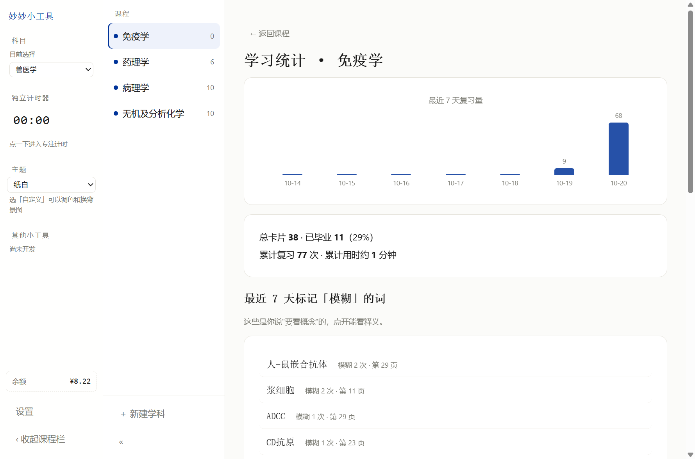
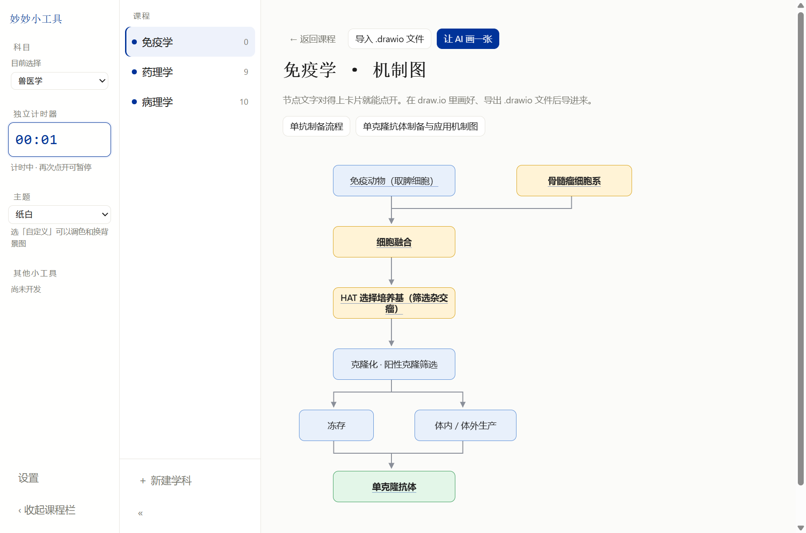

# 老郑荡的妙妙小工具

**把老师的 PDF 课件，变成能考的知识卡。**

Windows 桌面应用 · 完全离线可用 · 数据全在本机 · 开源（AGPL-3.0）

### 📥 [**点这里下载（Windows 免安装，解压双击即用）**](https://github.com/laozhengdang/miaomiao-study/releases/latest)

> 178 MB · 不需要装 Python / Node / 数据库 · 所有依赖都已打包
> 第一次运行若提示"Windows 已保护你的电脑"，点「更多信息」→「仍要运行」（个人项目没买代码签名，这是正常现象）



---

## 目录

- [这是什么](#这是什么)
- [为什么要做这个](#为什么要做这个)
- [功能总览](#功能总览)
  - [一、导入与整理](#一导入与整理)
  - [二、复习](#二复习)
  - [三、知识库](#三知识库)
  - [四、考前](#四考前)
  - [五、统计与小工具](#五统计与小工具)
- [设计上的几个取舍](#设计上的几个取舍)
- [快速开始](#快速开始)
- [数据放在哪](#数据放在哪)
- [常见问题](#常见问题)
- [技术栈](#技术栈)
- [已知限制](#已知限制)
- [文档](#文档)
- [许可](#许可)

---

## 这是什么

大学里有很多课，是要背的：兽医免疫学、药理学、病理学、生物统计……
老师给的是一份几百页的 PPT 转的 PDF，你知道考点就在里面，但**你不知道从哪儿背起**。

这个工具做的事很朴素：

1. 你把课件 PDF 拖进来
2. 它把里面的术语、概念、机制**抽出来做成卡片**（正面是名词，背面是课件原文片段 + 出处）
3. 你每天刷 10 张，用四档自评告诉自己"记住了 / 模糊 / 全忘了"
4. 它按**间隔重复**帮你排下一次复习的时间
5. 考前一天，一键生成**复习清单**、**模拟卷**和**机制图**

不需要联网，不需要注册账号，不需要把课件上传到任何服务器。

---

## 为什么要做这个

市面上的背单词软件（Anki、Quizlet）都要求**你自己先做卡**。
但一学期七八门课、每门几百页课件，手工做卡的时间比背书还长。

已有的"AI 做卡"工具大多是网页版：要登录、要上传课件、要联网、按次收费，而且**不认识中文课件的排版**——
它们不知道老师用红字标的才是重点，不知道"第三章"是标题而不是术语，也不知道"包括 A、B、C"其实是一条包含关系。

这个工具就是为这件事写的：**认中文课件、认红字、认章节、认"包括/分为"句式**，
然后让 AI 在本地抽出的草稿上再做一遍"这词考试会不会考"的判断。

---

## 功能总览

### 一、导入与整理

| 功能 | 说明 |
|---|---|
| **拖拽导入** | 从文件夹或微信窗口，直接把 PDF 拖进程序窗口 |
| **多选批量导入** | 一次选多个文件，按顺序逐个导入，进度条按文件推进；某个失败不影响后面的 |
| **导入前探测** | 选完文件先告诉你：**多少页、多少张图、AI 整理要多少次调用、大概几块钱、几分钟**，再决定要不要跑 |
| **四种解析方式** | 授课课件（按红字与版式）/ 题库真题（按题号切题，答案置顶）/ 复习资料（按条目切）/ 考纲提纲（按行拆考点），选错类型会明显影响结果 |
| **理论课 / 实验课分开** | 同一门课可以同时有理论和实验两套卡，仓库里能单独筛 |
| **无 AI 降级** | 不配 API Key 也能导入，会按课件排版出一版卡片；只是术语质量差一些 |
| **AI 精修** | 配了 Key 后，AI 在本地草稿上重新判断术语、补释义、标重要度 |
| **AI 自审（判卷式）** | 精修完再让 AI 复核一遍：「这词考试真的会考吗」，把「第三章」「主要内容」这类垃圾词刷掉 |
| **待审队列** | AI 刷掉的词不进垃圾桶，进「待审」——你觉得它删错了，可以一键捞回 |
| **批次管理** | 每份课件是一批：可移除（卡片归档，不硬删）、可恢复、可**单独重跑**（课件改了只重解析那一批） |
| **出处可追溯** | 每张卡都记着它来自哪份文件、哪一章、第几页 |

### 二、复习

| 功能 | 说明 |
|---|---|
| **四档自评** | ①记得（以后不用再考）②记得（不用看概念）③模糊（要看概念）④完全不记得 —— 四个按钮**整块上色**（绿/蓝/黄/红），扫一眼就能选 |
| **间隔重复** | 简化版 SM-2：①毕业出池 ②间隔 ×2.5 ③间隔 ×1.2 且记为 leech ④重置。忘了的会更快回来 |
| **每日限额** | 默认每天 10 张新卡 + 5 张复习，可自己调 |
| **凌晨 4 点换日** | 熬夜到 2 点刷的卡算"今天"，不会因为过了零点就重置 |
| **复习乱序** | 可选：每天把卡的顺序打散，避免"第 5 张永远是同一个词" |
| **双计时器** | 页面总时长 + 单卡时长。单卡超过 90 秒变红提醒，但**绝不替你选择** |
| **专注模式** | 点左栏时钟进入全屏，只剩大时钟；满 30 分 / 1 小时 / 1.5 / 2 / 3 小时会给一句鼓励；支持 15/25/45 分钟**倒计时** |
| **再来一轮** | 今天刷完了还想刷，随机抽 20 张再从第 1 轮开始 |
| **结算页** | 今天四档分布、明天到期多少张、**连续学习天数**；今天标了「以后不用再考」的卡会列出来，标错了当场捞回 |
| **闪卡交互** | 正面只有名词，点一下出释义，再点出机制图——逼你先自己回想 |


### 三、知识库

| 功能 | 说明 |
|---|---|
| **五种仓库视图** | 按页码 / 按章节 / 按小节（页码断档自动切节）/ 按重要度 / A→Z |
| **四种筛选** | 全部 / 只看薄弱的 / 只看 4★ 以上 / 只看有图的，可叠加理论-实验筛选 |
| **全局检索** | `Ctrl + K` 跨所有课程搜术语，回车直达 |
| **卡片详情** | 释义正文 + 出处（章节 · 页码 · 文件名）+ 星级 + 复习状态 |
| **配图** | 从课件里自动抠出的图；点开是全屏查看器，能**滚轮缩放、按住拖动、←/→ 翻页** |
| **机制图** | 挂在释义下面，不是单独一个页面；图里的节点和卡片文字对得上就能点进去 |
| **卡片编辑** | 改标题和释义、**换配图 / 去掉配图**、**恢复成导入时的原版**、并入其它卡（别名合并）、**加/删关联** |
| **关系图** | 所有概念之间的关系网络，节点可点 |
| **错题本** | 模拟卷答错的题自动进来 |
| **待修队列** | 释义有问题的卡（比如抓错了段落）可以标「待修」，单独排队处理 |

### 四、考前

| 功能 | 说明 |
|---|---|
| **一键复习清单** | 把整门课按章整理：每章的术语 + 这一章在讲什么 + 一段「融会贯通」的主线，可导出 Markdown 打印 |
| **模拟卷** | 随机抽题成卷，带**答题卡**、倒计时、交卷后**逐题解析**（对在哪、错在哪、出自哪一页） |
| **考前抽检** | 随机抽 5~20 张，答不上的直接打回复习队列——考前一晚用来找漏 |
| **考试模式** | 填考试日期，按剩余天数倒推每天要刷多少张；算出来超过 60 张/天会直接告诉你「这个计划不现实」 |
| **机制图批量生成** | 让 AI 按章挑概念、排关系、画图，一章一张（最多 6 张） |



### 五、统计与小工具

| 功能 | 说明 |
|---|---|
| **学习统计** | 最近 7 天复习量柱状图、总进度、累计复习次数与**累计时长**、各章掌握度、**最近 7 天标「模糊」的词**（点一下跳到那张卡） |
| **计算器** | 两种打开方式：左栏按钮，或**鼠标移到窗口右边缘**（把手自动滑出，点一下贴右侧展开，不遮挡题目）。**高精度**（`0.1+0.2` 就是 `0.3`）。支持**单位与量纲**：`120 km/h to m/s`、`5 mol/L * 2 L`、`2 kg * 3 m/s² → 6 N`、`30 C to F`，单位对不上会直接告诉你「量纲不一致」；支持**变量**（`x=3; x^2`）。函数：三角/反三角/双曲、`ln` `lg` `log(x,底)`、`eˣ`、根、阶乘、组合 `C(n,k)` 排列 `P(n,k)`、`Σ` `Π` 均值 标准差、取整、物理化学常数。**55 个按键**、角度制可切、历史记录、记忆键 `M+ M− MR MC`、隐式乘法（`2π`、`3(1+2)`）、中文全角符号也认 |
| **余额显示** | 左栏底部实时显示 DeepSeek 余额（每分钟最多查一次），低于 1 元会给提示；鼠标悬停看今天调用了多少次 |
| **主题** | 纸白 / 米黄 / 夜间 / **自定义**（自己调配色 + 换背景图） |
| **名言库** | 内置 **134 条**（古典、近现代、外国名人）+ 你自己写的；**每次启动随机换一句**，最近 8 句不重复，开屏和首页各取一句 |
| **三步引导** | 第一次打开：选专业 → 建第一门课 → 要不要接 AI，三步走完直接进课程 |
| **数据自检** | 一键检查：重复词、缺释义、垃圾术语、失效的机制图关联、孤立的出处，出报告 |
| **导出** | 卡片导出 Markdown（按章节排版）/ CSV（Excel 直接开）/ **备份整个数据库** |

---

## 设计上的几个取舍

**宁可多一张垃圾卡，不可漏一个考点。**
AI 判断"这词要不要留"时偏保守，刷掉的词进「待审」而不是直接删。删掉一个考点的代价，比多背十个没用的词大得多。

**卡片不硬删除，只归档。**
移除一批课件、合并一张卡，都是改状态而不是 `DELETE`。误操作能救回来。

**复习时先自己回想，再给答案。**
正面只有名词，点一下才出释义。这不是花哨，是为了制造"回忆"这个动作本身。

**计时器只提醒，不替你选。**
单卡超时变红、专注满 1 小时给鼓励，但永远不会自动跳过或自动判分。

**所有数据在本地。**
课件、卡片、复习记录、API Key 全在 `data/` 文件夹，一个 SQLite 文件。没有账号系统，没有云端同步，没有"隐私政策"要读。

---

## 快速开始

### 拿到成品

到 [**Releases**](https://github.com/laozhengdang/miaomiao-study/releases/latest) 下载
`miaomiao-study-v0.9.0.zip`（178 MB），解压后双击 `老郑荡的妙妙小工具.exe`。

**不需要装 Python、不需要装 Node** —— Electron 引擎、Python 3.12、PyMuPDF 全部打包在里面。

第一次打开：左边「＋ 新建学科」→ 进这门课 →「＋ 导入课件到本学科」→ 选 PDF。
想用 AI 功能（整理术语 / 画机制图 / 复习清单）：左栏「设置」里填一个 API Key（推荐 DeepSeek，几毛钱一份课件）。

### 从源码跑

**最省事**：双击 `一键安装.bat`，它会自动检查 Node/Python、装依赖、验证，然后启动。

手动也行：

```bash
npm install
npm start          # Electron 跑源码
npm run web        # 或者起个本地网页版（http://127.0.0.1:5180）
```

需要 Node 22+；`npm start` 想导入 PDF 的话还需要系统里有 Python 3.10+ 和 `pip install pymupdf`。
（成品包里用的是内置 Python，跳过这一步。）

### 让 AI 帮你装

仓库根目录有个 [AGENTS.md](AGENTS.md)，是**写给 AI 编码助手看的安装说明**
（依赖版本、国内镜像、验证命令、关键约束、常见报错都在里面）。

把这句话连同仓库地址发给你的 agent：

> 按仓库里的 AGENTS.md 把这个项目跑起来。我的电脑上没有开发环境，
> 如果装不上就直接告诉我该下哪个成品包。

如果你只是要用，别让 AI 折腾——直接下 Release 的 zip 最快。

### 打包成可分发版本

见 [docs/发布清单.md](docs/发布清单.md)。简单说：

1. 把 Electron 发行版放到 `build/老郑荡的妙妙小工具/`
2. 把 Python 嵌入式版解压到 `runtime/python/`，`pip` 装好 `pymupdf`
3. 双击根目录的 `打包.bat`（内部调 `node tools/pack.mjs`，会校验代码是否真的复制过去了）

---

## 数据放在哪

```
build/老郑荡的妙妙小工具/data/
├─ db/app.db        ← 卡片、复习记录、设置（含 API Key）
├─ images/          ← 从课件里抽出的图
├─ source_pdfs/     ← 你导入的原始课件
└─ reports/         ← 自检报告
```

**整个仓库里没有课程数据**，`.gitignore` 里排除了 `data/`、`runtime/`、`build/`。
想检查自己库里的数据有没有问题：双击程序目录下的 `自检.bat`。

---

## 常见问题

**Q：第一次打开跳出"Windows 已保护你的电脑"？**
A：因为没买代码签名证书（一年几千块）。点「更多信息」→「仍要运行」即可。

**Q：不填 API Key 能用吗？**
A：能。导入、复习、模拟卷、统计全都不要钱、不要网。只有「AI 整理术语」「AI 画机制图」「AI 写复习清单」需要 Key。

**Q：会花多少钱？**
A：用 DeepSeek 的话，一份 140 页的课件，AI 整理 + 自审大约 **1 元左右**；一张机制图几分钱。导入前会先给你估。

**Q：我的课件会被上传吗？**
A：不会。PDF 解析在你自己的电脑上跑（本地 Python）。只有「AI 整理」这一步会把**抽出来的文字片段**发给模型服务商，图片和原始文件不出本机。

**Q：能同步到别的电脑吗？**
A：把 `data/` 文件夹拷过去就行。没有云同步，也不需要。

**Q：为什么余额有时候显示「未接入」？**
A：余额查询只支持 DeepSeek 官方接口。换成别家的 Key，功能照用，只是看不到余额。

---

## 技术栈

| 层 | 用了什么 | 为什么 |
|---|---|---|
| 外壳 | Electron 44 | 一个 exe 里带 Chromium + Node，用户不用装运行时 |
| 数据库 | Node 内置 `node:sqlite` | 不需要编译原生模块，拷走就能用 |
| 前端 | 原生 HTML/CSS/JS，无框架、无构建 | 改一行就生效，十几兆内存，启动快 |
| PDF 解析 | PyMuPDF（打包 Python 3.12） | 抽文字、抽图、读字体颜色都得靠它 |
| AI | OpenAI 兼容接口（默认 DeepSeek） | 用户自带 Key，不绑死某一家 |
| 计算器 | 手写递归下降解析器 | 不引第三方数学库，可单测（57 条断言） |

整个项目没有前端构建步骤：`app/public/` 里改完保存，刷新就见效。

---

## 已知限制

写出来是因为**不想让人下载完才发现**：

- 机制图节点多的时候（超过 10 个），连线仍可能交叉，排版不够漂亮
- 别名只能合并，不能拆分，也不能改"首选词"
- 小节切分是"页码断档自动切"，不是 AI 理解内容后切
- 图片查看器不能并排对比两张图
- 不能导出课程包分发给别人（只能整个 `data/` 拷走）
- 只支持 PDF；PPT 需要先自己转成 PDF
- 只做了 Windows 版

---

## 文档

- [需求与决策](docs/需求与决策.md)：所有功能取舍与理由（D1–D99），改代码前先看这个
- [页面清单](docs/页面清单.md)：产品全貌（30 个页面）
- [功能对照](docs/功能对照.md)：设计 vs 实现，哪些做完了、哪些还差
- [功能总账](docs/功能总账.md)：逐条核对过对话里的每条要求
- [检查清单](docs/检查清单.md)：35 项人工验收步骤
- [发给同学](docs/发给同学.md)：怎么把成品发给别人
- [发布清单](docs/发布清单.md)：发版前要做什么
- [AGENTS.md](AGENTS.md)：给 AI 助手的安装说明

---

## 许可

AGPL-3.0（因为打包了 AGPL 的 PyMuPDF）。第三方组件见 [THIRD_PARTY.md](THIRD_PARTY.md)。

本工具与任何学校、课程、老师无关，是一个学生自己复习用的东西。课件版权归原作者。
