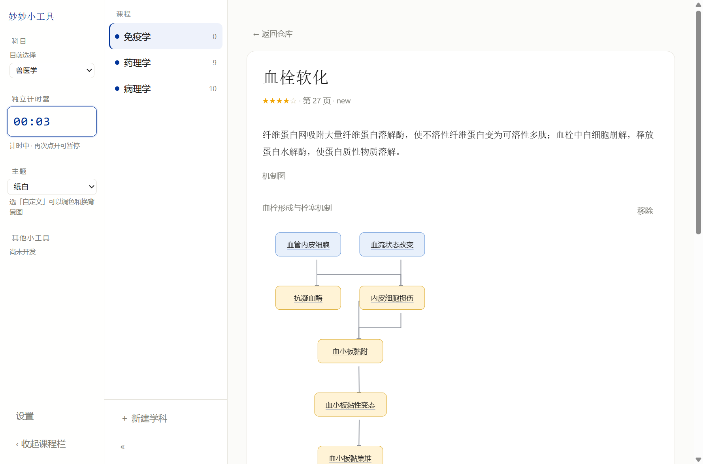

# 老郑荡的妙妙小工具

### 📥 [**点这里下载（Windows 免安装，解压双击即用）**](https://github.com/laozhengdang/miaomiao-study/releases/latest)

> 178 MB · 不需要装 Python / Node · 数据全在本机
> 第一次运行若提示"Windows 已保护你的电脑"，点「更多信息」→「仍要运行」（没买代码签名，正常现象）

---

把老师的课件（PDF）丢进去，自动整理成**能考的知识卡**，用「四档自评 + 间隔重复」复习；
考前还能一键生成**复习清单**、**机制图**和**模拟卷**。

给兽医 / 动物科学 / 草业这类需要背大量名词的课准备的。**所有数据都在本机，不上传。**




---

## 它能干什么

| 环节 | 你会看到 |
|---|---|
| **导入** | 拖一份 PDF 进来，先告诉你「142 页 / 22 张图 / AI 整理约 1 元」，再决定要不要跑 |
| **整理** | 本地先出草稿；配了 API Key 后，AI 抽术语 → 再自己复核一遍「这词考试会不会考」 |
| **复习** | 每天 10 张新卡。四档自评（记得/记得不用看概念/模糊/不会），间隔重复自动排期 |
| **看释义** | 卡片背面是课件原文片段 + 出处（哪章、第几页、哪份文件），配了机制图就在下面 |
| **考前** | 一键生成「必备清单」（按章汇总 + 每章逻辑 + 融会贯通）、模拟卷（答题卡 + 倒计时 + 逐题解析） |
| **找自己** | 错题本、学习统计（7 天曲线 / 各章掌握度 / 累计时长）、考试模式（按考试日期倒推每天刷多少） |


---

## 怎么用

### 拿到成品

到 [**Releases**](https://github.com/laozhengdang/miaomiao-study/releases/latest) 下载
`miaomiao-study-v0.9.0.zip`（178 MB），解压后双击 `老郑荡的妙妙小工具.exe`。

**不需要装 Python、不需要装 Node** —— Electron 引擎、Python 3.12、PyMuPDF 全部打包在里面。
（想自己打包发给别人，见 [docs/发布清单.md](docs/发布清单.md)。）

第一次打开：左边「＋ 新建学科」→ 进这门课 →「＋ 导入课件到本学科」→ 选 PDF。
想用 AI 功能（整理术语 / 画机制图 / 复习清单）：左栏「设置」里填一个 API Key（推荐 DeepSeek，几毛钱一份课件）。

### 从源码跑

```bash
npm install
npm start          # Electron 跑源码
npm run web        # 或者起个本地网页版（http://127.0.0.1:5180）
```

需要 Node 22+；`npm start` 想导入 PDF 的话还需要系统里有 Python 3.10+ 和 `pip install pymupdf`。
（成品包里用的是内置 Python，跳过这一步。）

### 打包成可分发版本

见 [docs/发布清单.md](docs/发布清单.md)。简单说：

1. 把 Electron 发行版放到 `build/老郑荡的妙妙小工具/`
2. 把 Python 嵌入式版解压到 `runtime/python/`，`pip` 装好 `pymupdf`
3. 双击根目录的 `打包.bat`

---

## 数据放在哪

```
build/老郑荡的妙妙小工具/data/
├─ db/app.db        ← 卡片、复习记录、设置（含 API Key）
├─ images/          ← 从课件里抽出的图
├─ source_pdfs/     ← 你导入的原始课件（没复制的话就是路径引用）
└─ reports/         ← 自检报告
```

**整个仓库里没有课程数据**，`.gitignore` 里排除了 `data/`、`runtime/`、`build/`。
想知道自己库里的数据有没有问题：双击程序目录下的 `自检.bat`。

---

## 文档

- [需求与决策](docs/需求与决策.md)：所有功能取舍与理由（D1–D99），改代码前先看这个
- [页面清单](docs/页面清单.md)：产品全貌
- [功能对照](docs/功能对照.md)：设计 vs 实现，哪些做完了、哪些还差
- [检查清单](docs/检查清单.md)：35 项人工验收步骤
- [发给同学](docs/发给同学.md)：怎么把成品发给别人
- [发布清单](docs/发布清单.md)：发版前要做什么

---

## 许可

AGPL-3.0（因为打包了 AGPL 的 PyMuPDF）。第三方组件见 [THIRD_PARTY.md](THIRD_PARTY.md)。

本工具与任何学校、课程、老师无关，是我自己复习用的东西。课件版权归原作者。
